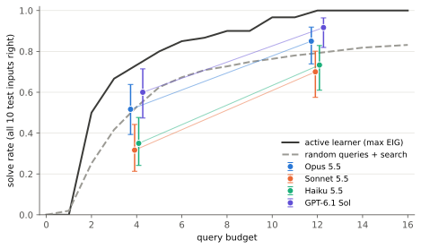
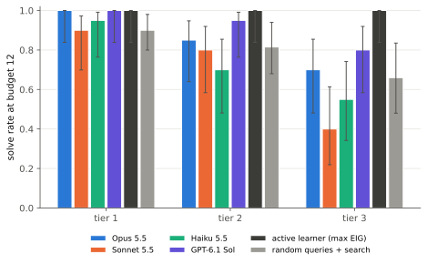
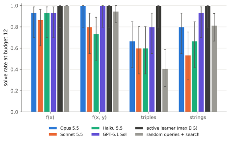
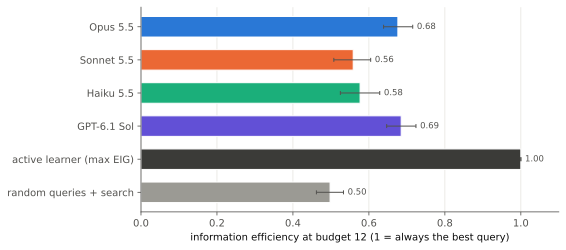
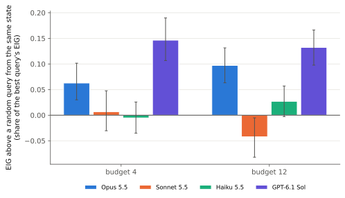
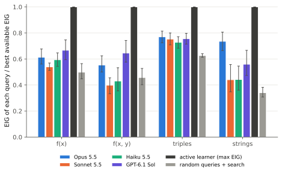
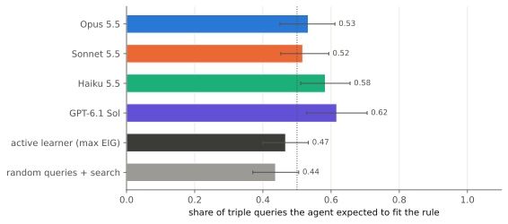

<p align="center"></p>

# sleuth

sleuth is a benchmark for whether a language model can do science on a black box. The box hides a rule. The model gets a fixed number of experiments. Before each one it writes down what it currently believes, then it picks an input and sees the output. When it stops, it has to predict the box's output on inputs it hasn't seen, chosen to catch rules that look right but aren't. Every rule comes from a small DSL, so two reference agents can search exactly the space the rules come from, and every query the model makes can be scored by how much it could have told it.

## Why I built this

Most reasoning benchmarks hand the model all the evidence and ask for an answer. Science doesn't work like that. You decide what to look at, and the hard part is choosing an experiment whose result you can't already predict. People are famously bad at this. In Wason's 2-4-6 task, most subjects guess "numbers going up by two" and then test triples like 8-10-12, which fit their guess and so can't tell them anything. The real rule is "any increasing triple", and they rarely find it, because they never try a triple they expect to fail.

I wanted to know whether models do the same thing. Do they pick informative experiments, or poke around and then confirm their first guess? Accuracy at the end doesn't answer that on its own, because a model can get there by luck or by spending more queries. So sleuth also measures each query against an ideal experimenter that searches the same hypothesis space.

## Short version of what I found

I ran four models, Claude Opus 5.5, Sonnet 5.5 and Haiku 5.5 through `claude -p` and GPT-6.1 Sol through `codex exec`, on 60 tasks at budgets of 4 and 12 experiments. That's 480 episodes and 4,080 recorded model calls. Intervals are 95%, over tasks.

- **At 12 experiments, GPT-6.1 Sol solved 92% [82, 96] of tasks and Opus 5.5 85% [74, 92].** Sonnet 5.5 solved 70% [57, 80] and Haiku 5.5 73% [61, 83], both below the 79% [71, 87] of random queries followed by exhaustive search over the DSL. The active reference agent solved all 60, using 6.2 queries on average against the models' 8.8 to 12.
- **Only two of the four models pick better experiments than chance.** Measured against a random input from the same point in the same notebook, GPT-6.1 Sol's queries are worth 13% [10, 17] more of the best available information and Opus's 10% [6, 13] more. Haiku's are level with random, +2.7% [−0.3, 5.7], and Sonnet's are slightly worse, −4.2% [−8.2, −0.5]. Whatever Sonnet and Haiku solve, they solve by reading the notebook. Their choice of what to look at adds little or nothing.
- **All four are far from the ideal experimenter.** Their queries carry 56% to 68% of the expected information of the best query available at the time. Between 10% and 19% of their queries at budget 12 could not have taught them anything, because every rule still consistent with the notebook predicted the same answer. For random queries the figure is 27%.
- **On the 2-4-6 style triples, models lean slightly towards positive tests, but not much.** They expected 52% to 62% of their triple queries to fit the rule, against 47% [40, 53] for the active learner. Only GPT-6.1 Sol's 62% [53, 71] clearly separates from it. Every model ran plenty of negative tests. The textbook failure still turns up in single episodes. Haiku decided the rule was "all three are even", ran five more triples that each came back as that guess predicted, and finished at 50% accuracy on a rule about b alone.
- **Triples are where models beat blind search.** At 12 experiments the models solved 60% to 80% of triple tasks, against 41% for random queries with perfect inference. One bit per query punishes careless experiments. At 4 experiments almost nothing solves a triple. Even the active learner manages 7%.
- **Difficulty tiers work for models.** Every model's solve rate falls from tier 1 to tier 3 at budget 12, from 90% to 40% for Sonnet and from 100% to 80% for GPT-6.1 Sol. The active learner solves every tier.
- **Models mostly spend the whole budget.** Haiku used all 12 experiments in 59 of 60 episodes. GPT-6.1 Sol stopped early in 62% of them, Sonnet in 40% and Opus in 22%.
- **The action format was not a problem.** 43 of 4,080 replies were invalid (1.1%), and only one of them came from GPT-6.1 Sol. One episode forfeited its test after three bad replies in a row. No tool call appeared in any recorded call.

## Contents

- [How it works](#how-it-works)
- [Results](#results)
- [Limitations](#limitations)
- [Quickstart](#quickstart)
- [Layout](#layout)
- [Tests](#tests)

## How it works

### The boxes

Rules come from four families. Each has its own DSL, and `sleuth.dsl` enumerates every program up to a size limit, smallest first, keeping one program per distinct behaviour on a probe set of inputs. The smallest program for a behaviour sets its size, and the size sets its tier.

| family | input | output | built from | space | tiers by size |
| :--- | :--- | :--- | :--- | ---: | :--- |
| `int1` | x in [-50, 50] | integer | x, constants 1 2 3 5 10, + - *, min, max, abs, mod k, div k, & \| ^, if x < c / x even | 94,750 rules up to size 7 | 3 / 4-5 / 6-7 |
| `int2` | x, y in [-20, 20] | integer | the same with x, y, constants 1 2 3, and tests x < y, x == y, x < 0, y < 0, x even | 10,714 up to size 6 | 3 / 4-5 / 6 |
| `triple` | [a, b, c], each in [0, 30] | true / false | 30 conditions (orderings, equalities, parity, a + b = c, arithmetic progression, doubling, sum thresholds, multiples of 3, which is largest) with and, or, not | 24,104 up to size 5 | 1-2 / 3 / 4-5 |
| `string` | 1 to 8 lowercase letters | string | 15 transforms (reverse, sort, rotate, Caesar shifts, drop first/last, double, every other letter, collapse runs, swap pairs, drop vowels, dedupe) and concat | 14,210 up to size 5 | 3 / 4 / 5 |

The model sees the same description of the primitives, the input domain and the size limit that the reference agents search. For `int1` and `int2` the probe set is the whole domain, so two rules with the same signature really are the same rule. For triples and strings the probe set is 2,367 triples and 232 strings, and a query outside it is evaluated rule by rule.

The `triple` family generalises Wason's task. Each episode starts with one triple that fits the rule, taken from a list of prototypes like 2-4-6, 1-2-3 and 3-6-9, so the obvious first guess ("steps of two", "all even") is narrower than the rule.

### Tasks and calibration

`sleuth tasks` draws five rules per family and tier from a seed, 60 in all, and throws some away:

- **degenerate**: an integer rule with a single output value, or a triple rule that's true on fewer than 5% or more than 85% of the probe set;
- **trivial**: the active reference agent gets the whole test set right after one query;
- **impossible**: it can't get the whole test set right within 12 queries.

How many rules were drawn and kept, why the rest were rejected, and the median number of queries the active learner needed:

| family | tier 1 | tier 2 | tier 3 |
| :--- | :--- | :--- | :--- |
| `int1` | 5 of 15 kept (6 degenerate, 4 trivial); active needs 2 | 5 of 6 kept (1 degenerate); active needs 2 | 5 of 5 kept; active needs 3 |
| `int2` | 5 of 7 kept (1 degenerate, 1 trivial); active needs 2 | 5 of 7 kept (2 trivial); active needs 3 | 5 of 5 kept; active needs 3 |
| `triple` | 5 of 8 kept (3 degenerate); active needs 5 | 5 of 8 kept (3 degenerate); active needs 8 | 5 of 27 kept (8 degenerate, 12 impossible, 2 no starting example); active needs 10 |
| `string` | 5 of 15 kept (10 trivial); active needs 2 | 5 of 9 kept (4 trivial); active needs 2 | 5 of 8 kept (3 trivial); active needs 2 |

Integer and string outputs carry many bits per query, so the active learner pins most rules down in two or three queries. Triples carry at most one bit, so they take five to ten even for it, and 12 of the 17 non-degenerate tier 3 triple rules it saw were too hard to separate from their near misses in 12 queries. The tiers order difficulty for the models more than for the active learner, as [Results](#results) shows.

### The protocol

Each turn is one stateless call. The prompt re-sends everything: the box's description, the budget, and a lab notebook of every earlier experiment with the hypothesis and prediction the model wrote before running it. The reply must be exactly one JSON object:

```json
{"hypothesis": "a < b < c", "query": [5, 3, 9], "prediction": false}
{"hypothesis": "any triple with c the largest", "commit": true}
```

Because the prompt is a pure function of the history and the box is a pure function of the input, a recorded episode replays exactly. A notebook line looks like this:

```
3. [1, 9, 3] -> true (you predicted false). Your hypothesis then: "c is the largest entry"
```

Parsing is strict. No prose, no code fence, no extra keys, a query inside the domain, and a prediction of the right type, so a JSON boolean for triples and never `1`. A reply that breaks any of that is an invalid action. It is counted, the next prompt says what was wrong, and it doesn't use up an experiment. Three invalid replies in a row end the phase.

After the model commits, or runs out of budget, it sees ten new inputs and predicts the output of each. The score is exact accuracy on those ten, and a task counts as solved when all ten are right. Nothing parses the hypothesis text.

### The test set

Ten inputs per task, picked to separate the rule from its near misses. Near misses are the hypotheses that agree with the rule on a few easy inputs, such as 0 to 5, 2-4-6 style triples or short strings, plus the ones that agree with it most often anywhere. Seven inputs are picked greedily, each one separating the closest near miss still standing, and three are random. Triple test sets have at least three trues and three falses. A model that stops at "x mod 5" when the rule is "x mod 5 plus a special case below zero" fails some of them.

### Reference agents

Both reference agents keep the version space, the hypotheses still consistent with everything seen, and predict with its smallest program:

- **random queries + search** asks probe inputs uniformly at random.
- **active learner** asks the probe input with the highest expected information gain over the version space. For a deterministic box that is the entropy of how the version space splits on the input's output. It stops when only one behaviour is left.

Both search the same space the rules were drawn from, so they know more than the model does, and the active learner is an approximate upper bound on what a query can be worth. They run on the same 60 tasks with the same budgets, the random one with ten seeds per task.

### What gets measured

For every model query, sleuth replays the history into the hypothesis space and computes, before the answer comes back:

- **EIG**, the expected information gain of the query, in bits;
- **best EIG**, the most any probe input would have given at that point;
- **random EIG**, what a uniformly random probe input gives on average.

**Information efficiency** is EIG / best EIG, averaged over queries made while more than one behaviour was left. A **zero-information query** is one whose answer every surviving hypothesis agreed on, so nothing could be learned from it. The **surprise rate** is the share of queries where the model's own prediction was wrong, and the **positive-test rate** on triples is the share of queries the model expected to fit the rule, the confirmation-bias measure from the 2-4-6 literature. All of these use a uniform prior over the version space. A model that believes simpler rules are likelier would value queries differently, and that's part of what the gap measures.

### Models and how they're called

| model | CLI | calls | effort |
| :--- | :--- | ---: | :--- |
| Claude Opus 5.5 (`claude-opus-5-5`) | Claude Code 2.1.316 | 1,048 | `--effort medium` |
| Claude Sonnet 5.5 (`claude-sonnet-5-5`) | Claude Code 2.1.316 | 1,012 | `--effort medium` |
| Claude Haiku 5.5 (`claude-haiku-5-5`) | Claude Code 2.1.316 | 1,095 | `--effort medium` |
| GPT-6.1 Sol (`gpt-6.1-sol`) | codex-cli 0.166.0 | 925 | `model_reasoning_effort=medium` |

Each model played all 60 tasks at both budgets, 120 episodes each. Up to six Claude calls and eight Codex calls ran at a time. A Claude call took about 6 seconds and a Codex call about 25, and the whole run, a small pilot included, took about an hour and three quarters.

sleuth has no API keys. It calls the headless agent CLIs, the way [retro](https://github.com/PDiTO/retro) does, and switches off everything that would let a model do more than chat. A model that could run code could enumerate the DSL and brute-force the box.

| CLI | flags |
| :--- | :--- |
| `claude -p` | `--system-prompt <ours>` replaces Claude Code's system prompt; `--tools ""` removes every built-in tool; `--strict-mcp-config` with no config loads no MCP servers; `--setting-sources ""` skips user and project settings, and with them hooks and plugins; `--disable-slash-commands`; `--no-session-persistence`; run in an empty temporary directory |
| `codex exec` | an isolated `CODEX_HOME` holding only the login and the model provider copied from your config; shell, unified exec, apps, browser, computer use, image tools, multi-agent, plugins, skills, hooks and memories all off; `web_search = "disabled"`; `project_doc_max_bytes = 0` so no AGENTS.md; `-s read-only` in an empty directory; `model_instructions_file` replaces Codex's base instructions with ours |

I checked both by asking the model to list its tools and to run Python. Claude reports no tools. Codex still lists a code-mode `exec` tool and its collaboration tools, but code mode fails closed because its host is disabled, and calling `exec` returns an error. sleuth counts any tool event in Codex's event stream, and the run recorded none. What remains in the context:

- Claude Code still appends an environment block to our system prompt: the date, the working directory, which is an empty temp dir, the platform and shell, and a short note about untrusted downloads.
- Codex still sends its tool schemas, about 6,000 input tokens on every call, plus its own environment context.

I didn't wire up `cursor-agent` or `opencode`. Cursor's `ask` and `plan` modes keep their read and search tools with no way to turn them off, and opencode would need a generated agent config with every tool disabled, which I haven't tested. Both would slot in behind `Provider`.

sleuth records every call, in one JSON file per episode under `results/recordings/<model>/` that holds the system prompt, every prompt and every reply with its timing and token counts. A call is keyed by a hash of the provider id, system prompt and prompt. Running again replays recorded calls from disk, so an interrupted run resumes where it stopped, and `sleuth report` rebuilds everything with no model at all, failing on any prompt it hasn't seen.

## Results

Everything here comes from `results/summary.json`, and the full tables are in [`results/report.md`](results/report.md).

### Solve rate against budget



The lines are the reference agents at every budget from 0 to 16, averaged over all 60 tasks, with ten seeds for the random agent. The points are the models at the two budgets they were run at. At 4 experiments GPT-6.1 Sol, at 60% [47, 71], and Opus, at 52% [39, 64], sit on the random-plus-search curve at 53%. Sonnet at 32% and Haiku at 35% sit below it. At 12 the two stronger models pull above it and the other two stay below. Nobody is near the active learner, which solves 73% of tasks with 4 queries.

| | budget 4 solve | budget 12 solve | budget 12 accuracy | queries used at 12 | stopped early at 12 |
| :--- | ---: | ---: | ---: | ---: | ---: |
| Opus 5.5 | 52% [39, 64] | 85% [74, 92] | 97% [94, 99] | 11.0 | 22% |
| Sonnet 5.5 | 32% [21, 44] | 70% [57, 80] | 92% [87, 96] | 10.3 | 40% |
| Haiku 5.5 | 35% [24, 48] | 73% [61, 83] | 92% [87, 96] | 12.0 | 2% |
| GPT-6.1 Sol | 60% [47, 71] | 92% [82, 96] | 98% [95, 100] | 8.8 | 62% |
| active learner | 73% [61, 83] | 100% [94, 100] | 100% | 6.2 | 75% |
| random + search | 53% [44, 62] | 79% [71, 87] | 95% [92, 97] | 9.2 | 44% |

"Stopped early" for the reference agents means the version space had shrunk to one rule.

### By tier and family





At 12 experiments f(x) is close to solved for every model, at 87% to 93%. f(x, y) splits them, with 100% for Opus and GPT-6.1 Sol, 80% for Sonnet and 73% for Haiku. Strings separate the models most: GPT-6.1 Sol 93%, Opus 80%, Haiku 67%, Sonnet 53%. Triples are hardest for everyone except the active learner. They are also the family where random queries do worst, at 41%, because each answer is one bit and most random triples answer a question you've already settled.

### Information per query



Information efficiency is the expected information of each query divided by the best available at that moment, so the active learner scores 1 by construction. At budget 12 Opus and GPT-6.1 Sol both score 68%, Haiku 58%, Sonnet 56% and the random agent 50%. The numbers are higher at budget 4, 69% to 82%, because the first queries are the easy ones. With a large version space almost any input splits it.

Efficiency alone flatters a model that ends up in easy positions, so the next chart compares each query with a random probe input from the same notebook state.



GPT-6.1 Sol's edge is +15% [11, 19] of the best query's value at budget 4 and +13% [10, 17] at 12, Opus's +6% [3, 10] and +10% [6, 13]. Sonnet and Haiku are within a few points of zero at both budgets, and Sonnet's −4.2% [−8.2, −0.5] at budget 12 means its later queries were slightly worse than picking an input at random. Whatever they solve comes from inference over the notebook, and that inference is weaker than exhaustive search. Random queries plus search beat both of them on the integer families and on strings.



Strings are where Opus stands out, at 74% against 44% to 56% for the other models. On triples all four models land between 73% and 77%, well above random (63%) and about level with each other.

| at budget 12 | efficiency | random query, same state | queries that couldn't teach anything | own prediction wrong |
| :--- | ---: | ---: | ---: | ---: |
| Opus 5.5 | 68% [64, 72] | 58% | 10% [6, 13] | 35% |
| Sonnet 5.5 | 56% [51, 60] | 60% | 14% [10, 19] | 42% |
| Haiku 5.5 | 58% [52, 63] | 55% | 19% [13, 25] | 37% |
| GPT-6.1 Sol | 68% [65, 72] | 55% | 13% [8, 17] | 38% |
| random + search | 50% [46, 53] | | 27% [22, 31] | 27% |

The last column is the surprise rate, the share of queries where the model's own stated prediction was wrong. A high surprise rate isn't bad in itself. The active learner's best guess is wrong on 46% of its queries, because it deliberately asks where its hypotheses disagree. A model that is rarely surprised is mostly confirming.

### Positive tests on triples



Wason's subjects mostly test triples they expect to fit. The models do a little of that. Opus and Sonnet expected 53% and 52% of their triple queries to fit, close to the active learner's 47% [40, 53]. Haiku at 58% [51, 66] and GPT-6.1 Sol at 62% [53, 71] lean further. GPT-6.1 Sol leans the most and is also the best at triples. My guess is that a positive test is fine when the hypothesis is broad, because then its positives are informative too. The overall rates hide the episodes where a model locks on, like this one.

```
$ uv run sleuth show results/recordings/claude_claude-haiku-5-5_medium/triple-t1-00-b12.json
triple-t1-00: not (b is a multiple of 3)  (claude/claude-haiku-5-5@medium, budget 12)
  given [2, 4, 6] -> true
   1! [1, 3, 5] -> false  (predicted true)  b - a = c - b (arithmetic progression, increasing)
   2! [2, 3, 6] -> false  (predicted true)  a is even
   3! [3, 6, 9] -> false  (predicted true)  a + b + c is even
   4  [6, 8, 10] -> true  (predicted true)  all three values are even
   5  [4, 6, 7] -> false  (predicted false)  all three values are even
   6  [10, 4, 2] -> true  (predicted true)  all three values are even
   7  [4, 3, 6] -> false  (predicted false)  all three values are even
   8  [0, 2, 28] -> true  (predicted true)  all three values are even
   9  [8, 14, 20] -> true  (predicted true)  all three values are even
  10! [1, 2, 4] -> true  (predicted false)  all three values are even
  11  [7, 10, 12] -> true  (predicted true)  b is even and c is even
  12  [25, 10, 30] -> true  (predicted true)  b is even and c is even
  final: b is even and c is even
  test accuracy 50%, 0 invalid replies
```

From the fourth query on, Haiku's hypothesis was "all three values are even". The next five triples all came back as that hypothesis predicted, three of them positive tests, so it learned almost nothing from them. The one surprise, 1-2-4 fitting, only moved it to "b and c are even". The rule was "b is not a multiple of 3".

## Limitations

These are the calls I made where the brief left room, and what they cost.

- **Small cells.** Five rules per family and tier, 60 tasks. Pooled numbers per model have usable intervals. A single family-by-tier cell has five episodes per model and tells you very little on its own.
- **Solved is not identified.** Ten test inputs aimed at near misses are a strong test but not a proof. A model can hold a rule that differs from the truth somewhere the test doesn't look and still score 10/10. The first version of the test set let exactly that through on a triple rule in the pilot, which is why near misses are now ranked by overall agreement, not only by agreement on easy inputs.
- **The calibration filters shape the task set.** "Impossible" means the active learner couldn't get the whole test set right within 12 queries. That rejected 12 of the 27 tier 3 triple rules drawn, including ones a person might find natural, such as "b is even, or c is even, or the triple is an arithmetic progression". Tier 3 triples are the hard rules that are still learnable in 12 queries, not hard rules in general.
- **Tiers are by program size.** Size orders difficulty for the models more than for the active learner, which pins most integer and string rules down in two or three queries whatever the tier. Smallest-program size is also a crude measure of how hard a rule is to think of. `x | 7` counts as size 4 because 7 has to be written `2 + 5`.
- **The reference agents know more than the model.** They search the exact enumerated space with a uniform prior over it. The model gets a prose description of the same primitives and the size limit, and has to guess the rest. The active learner is greedy, so it approximates the best possible experimenter rather than being one.
- **EIG uses a uniform prior over behaviours.** Most of the version space is large programs, so a query that only rules out exotic rules can carry a lot of uniform-prior information while telling a simplicity-minded experimenter little. A model that sensibly favours simple rules is marked down for it. The efficiency numbers are about information in this space, not about good judgement in general.
- **Probe sets.** For triples and strings, two rules count as the same if they agree on the probe set (2,367 triples, 232 strings), and the reference agents only ask probe inputs. The model can ask anything in the domain.
- **Two budgets for the models.** I ran the models at budgets of 4 and 12 only. The reference agents give a full curve from 0 to 16. Anything in between for the models is interpolation.
- **One sample per episode, no temperature control.** Neither CLI exposes sampling temperature, so each episode is one draw from whatever the CLI's default is. The recordings make every number reproducible, but rerunning the models would give somewhat different episodes.
- **Effort is fixed at medium** for every model, through `--effort` for Claude and `model_reasoning_effort` for Codex. That is a comparison of the CLIs' medium settings, which may not mean the same amount of thinking on both sides.
- **Harness contamination.** Claude Code still adds an environment block to the system prompt, and Codex still sends about 6,000 tokens of tool schemas and its own environment context with every call. The tools themselves are off or fail closed, and no tool event was recorded, but the two models are not seeing identical contexts.
- **Strict parsing counts format failures.** A code fence or one sentence after the JSON object is an invalid action. That is deliberate, but it measures instruction-following as well as reasoning. Invalid replies don't use up experiments, so their cost is a wasted call, not a wasted query.
- **Positive-test bias only exists for triples.** For integers and strings there's no natural "fits / doesn't fit", so the confirmation-bias measure is the zero-information rate instead.
- **One snapshot.** These are specific model versions behind specific CLI versions (Claude Code 2.1.316, codex-cli 0.166.0) in November 2026.

## Quickstart

You need [uv](https://docs.astral.sh/uv/). Rebuilding every number and chart in this README from the committed recordings takes a couple of minutes and calls no model:

```sh
git clone https://github.com/PDiTO/sleuth && cd sleuth
uv sync
uv run sleuth report        # results/summary.json, results/report.md, docs/*.svg
```

To look at one episode, where `!` marks a query the model's own prediction got wrong:

```
$ uv run sleuth show results/recordings/claude_claude-opus-5-5_medium/int1-t3-00-b12.json
int1-t3-00: min(5, (10 & min(x, 2)))  (claude/claude-opus-5-5@medium, budget 12)
   1! f(7) -> 2  (predicted 7)  f(x) = x
   2! f(13) -> 2  (predicted 3)  f(x) = x mod 5
   3  f(0) -> 0  (predicted 0)  f(x) = min(x, 2)
   4! f(-7) -> 5  (predicted -7)  f(x) = min(x, 2)
   5! f(1) -> 0  (predicted 2)  f(x) = 2*(x mod 3) for x >= 0, a different branch for x < 0
   6! f(2) -> 2  (predicted 0)  2*(x mod 3) for x >= 5, something else for x < 5 (f(0)=0, f(1)=0, f(-7)=5)
   7  f(-1) -> 5  (predicted 5)  for x >= 0: 2*min(x div 2, 1) (0,0,2,2,...); negatives unknown, maybe mod-based (f(-7)=5)
   8  f(-2) -> 5  (predicted 5)  if x < 0 then 5 else min(x, 2) & 2 (0,0,2,2,...) — negatives unclear
   9  f(-20) -> 5  (predicted 5)  if x < 0 then 5 else (0 for x in {0,1}, 2 for x >= 2)
  10  f(4) -> 2  (predicted 2)  if x < 0 then 5 else (0 for x in {0,1}, 2 for x >= 2)
  11  f(3) -> 2  (predicted 2)  if x < 0 then 5 else (0 for x in {0,1}, 2 for x >= 2)
  12  f(30) -> 2  (predicted 2)  if x < 0 then 5 else (0 for x in {0,1}, 2 for x >= 2)
  final: if x < 0 then 5 else (0 for x in {0,1}, 2 for x >= 2)
  test accuracy 80%, 0 invalid replies
```

Opus found the shape quickly. It tried four negative inputs, all of which gave 5, and concluded every negative input does. The rule is `min(5, 10 & min(x, 2))`, which for negative x depends on the bits of x, so its final rule failed two of the ten test inputs.

To run models yourself you need `claude` and/or `codex` installed and logged in:

```sh
uv run sleuth tasks                                   # regenerate results/tasks.json (deterministic)
uv run sleuth run --model claude:claude-haiku-5-5 --budget 12 --per-cell 1
uv run sleuth run --model codex:gpt-6.1-sol@high      # backend:model[@effort]
uv run sleuth prune                                   # drop recorded calls no replay uses
uv run sleuth report
```

A model spec is `claude:<model>` or `codex:<model>`, with an optional `@effort` (default `medium`). `run` prints how many calls it could make before it starts, reuses every recorded call, and writes each new one to disk as soon as it returns.

## Layout

```
src/sleuth/
  dsl.py           ops, programs, and the bottom-up enumerator with observational equivalence
  families.py      the four rule families: domains, primitives, probe sets, strict input parsing
  space.py         the enumerated hypothesis space, version spaces, entropy by column
  reference.py     random and max-EIG reference agents
  tasks.py         rule sampling, calibration filters, near-miss test sets
  protocol.py      the turn prompt, the test prompt, strict action parsing
  episode.py       one model playing one task
  providers.py     claude and codex backends with tools off, a scripted fake, the recorder
  runner.py        concurrent runs, resumable recordings, offline replay, prune
  analysis.py      per-episode rows: score, EIG, best EIG, surprises, positive tests
  stats.py         Wilson intervals and a task-cluster bootstrap
  report.py        summary.json, report.md and the charts
  plots.py         matplotlib SVGs
  cli.py           sleuth tasks | run | prune | report | show
results/
  tasks.json       the 60 tasks, with rules and test sets
  recordings/      every model call, one JSON file per episode
  summary.json     every number in this README
  report.md        the full tables
docs/              logo and charts
```

## Tests

```sh
uv run ruff check . && uv run ruff format --check .
uv run mypy
uv run pytest
```

The tests never touch the network. Model behaviour comes from a scripted fake provider, and the CLI backends are tested against recorded output shapes with a fake `exec`. They cover the DSL semantics against plain Python, strict parsing of every family's inputs and outputs, the enumerator, the entropy calculation, the reference agents, deterministic task generation, the protocol's handling of invalid replies, record and replay, and a full run, replay and report on a small task set. CI also rebuilds `results/summary.json` from the recordings and fails if it doesn't match the committed file.

## License

MIT. See [LICENSE](LICENSE).
